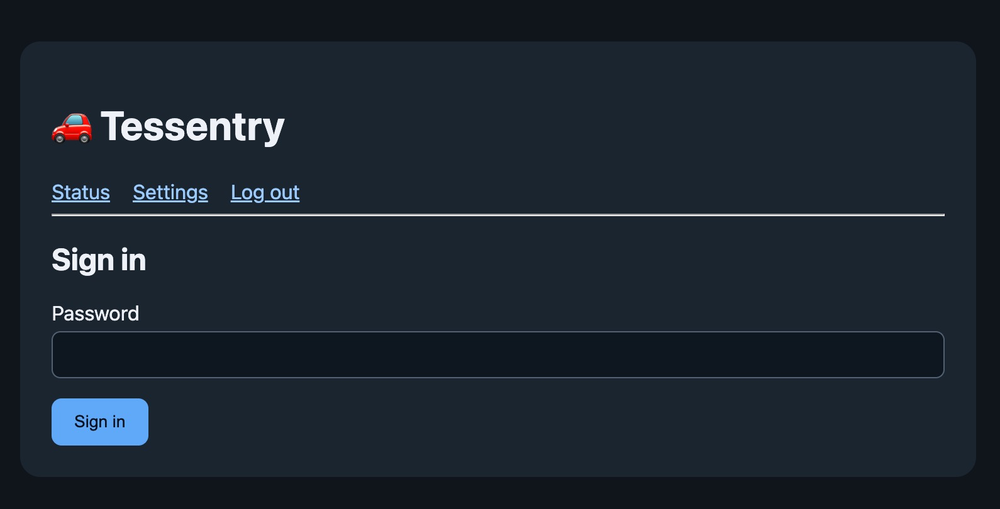
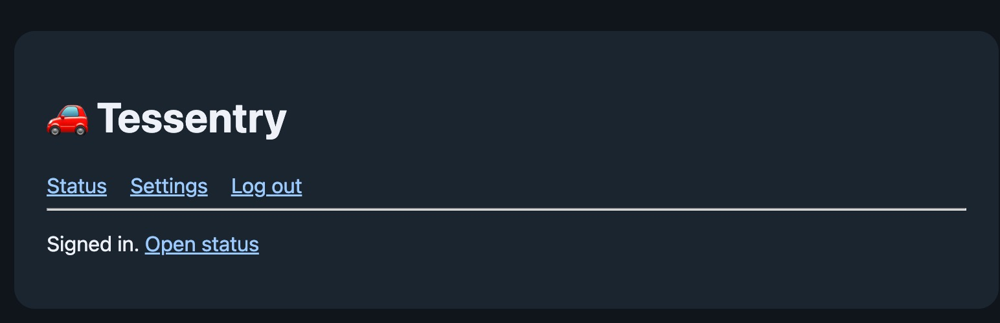
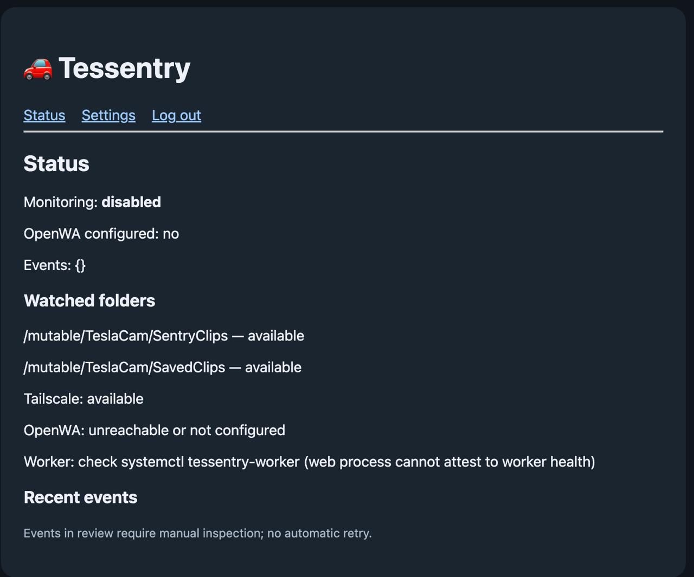
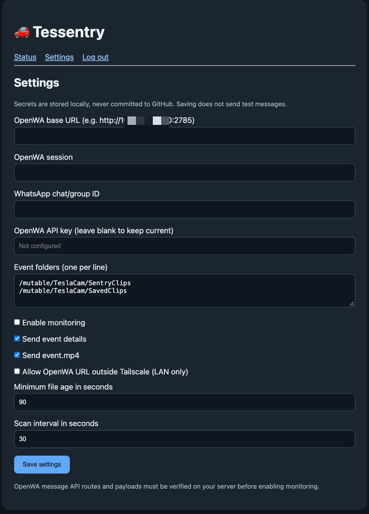
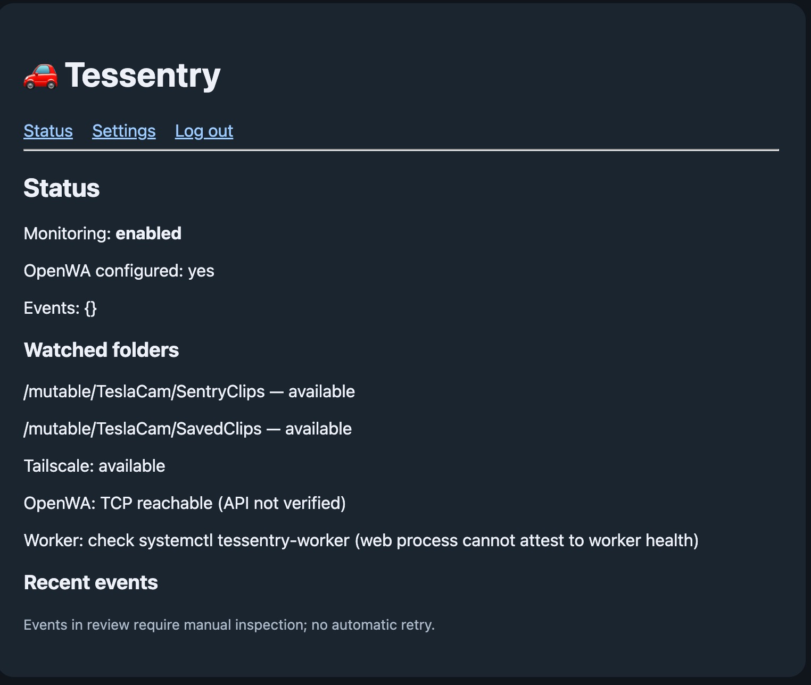
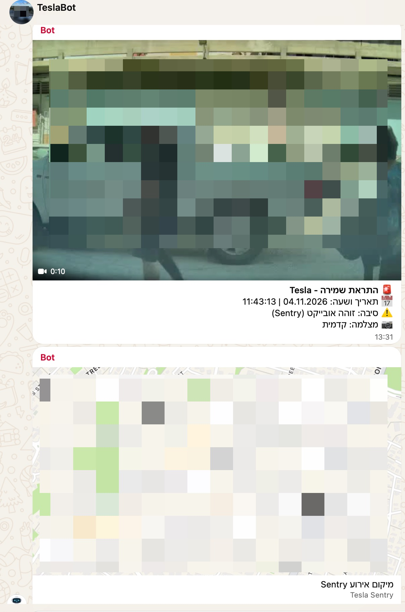

# Tessentry 🚗

**Tesla Sentry events → WhatsApp notifications, powered by Sentry-USB-Rusty, Tailscale and OpenWA.**

Tessentry is a lightweight companion service for a Raspberry Pi running [Sentry-USB-Rusty](https://github.com/Sentry-Six/Sentry-USB-Rusty). It watches configured TeslaCam `SentryClips` and `SavedClips` event folders and sends event information, a short `event.mp4` clip, and an optional native WhatsApp location message through OpenWA.

> **Start here: install Sentry-USB-Rusty first.** Tessentry is an add-on, not a replacement for the Tesla USB recorder or archive system. If Sentry-USB-Rusty is already installed and working, **do not reinstall it**.

## Installation roadmap

| Step | Component | Purpose |
| --- | --- | --- |
| **1** | **[Sentry-USB-Rusty](https://github.com/Sentry-Six/Sentry-USB-Rusty)** | Tesla USB recording, event storage and archiving — **required first** |
| 2 | [Tailscale](https://tailscale.com/) | Private connectivity between the Raspberry Pi and OpenWA |
| 3 | OpenWA / compatible WhatsApp API | Send WhatsApp notifications and video |
| 4 | **Tessentry** | Monitor new Sentry events and provide a configuration UI |

### Step 1 — Install Sentry-USB-Rusty (required)

Follow the **[official Sentry-USB-Rusty installation instructions](https://github.com/Sentry-Six/Sentry-USB-Rusty#install)**. For a supported Raspberry Pi, the upstream project provides a Raspberry Pi Imager manifest and a guided initial setup at `http://sentryusb.local`.

1. Install and configure Sentry-USB-Rusty according to its official guide.
2. Confirm the Pi is working with your Tesla and that recordings/events are being archived.
3. Confirm the locations of the `SentryClips` and `SavedClips` folders on **your** installation.
4. Keep Sentry-USB-Rusty running; Tessentry does not replace or reconfigure its archiving service.

**Important:** The upstream project notes that Tesla dashcam encryption can prevent Sentry USB from reading recordings. Review its current compatibility guidance before troubleshooting missing events.

### Step 2 — Set up Tailscale

Install and authenticate Tailscale on the Raspberry Pi and on the host running OpenWA. Verify that the Pi can reach the OpenWA server across your tailnet. Tessentry's installer expects Tailscale to be installed and running and binds the web interface to the Pi's current Tailscale IPv4 address.

### Step 3 — Prepare OpenWA

Set up an OpenWA/compatible WhatsApp API server and verify that it can send a message to a **test** chat or group. Have its server URL, session, API key (if required), and target chat/group ID ready. Never put these credentials in GitHub.

### Step 4 — Install Tessentry on the Raspberry Pi

Review `install.sh` before running it, especially on a read-only Sentry-USB-Rusty system:

```bash
git clone https://github.com/viko-repo/tessentry.git
cd tessentry
sudo bash install.sh
```

The installer checks that `/mutable` is writable, temporarily makes the root filesystem writable when needed, installs FFmpeg if required, installs Tessentry and its systemd services, and attempts to restore the original read-only state. It prints a generated administrator password on first installation; **save it securely**. Existing configuration and password are retained on subsequent installations.

> **Installation status:** A fresh install directly from this GitHub repository has not yet been independently validated. Use a backup and review the installer before deployment.

### Step 5 — Configure and enable monitoring

Open the web interface from a device on your tailnet:

```text
http://<PI-TAILSCALE-IP>:8788/tessentry/
```

Sign in with the installation password, then configure the OpenWA server URL, session, API key, target chat/group ID and the TeslaCam event folders. Confirm the paths match your installation. Test delivery to a non-production WhatsApp destination before enabling monitoring.

**Monitoring is disabled by default on a new installation.** Enabling it is an explicit configuration choice. Tessentry keeps an initial baseline to avoid sending old archived events as new alerts.

## Features

- Detects new events in configured `SentryClips` and `SavedClips` folders.
- Reads `event.json` when present for time, location, reason and camera details.
- Sends event details and an H.264-compatible `event.mp4` through the tested OpenWA integration.
- Can send a native WhatsApp location message separately from the video.
- Password-protected web UI for settings and status.
- SQLite-backed event tracking to avoid duplicate sends.
- Keeps Tessentry configuration and history under `/mutable/tessentry`.
- Does not intentionally modify TeslaCam recordings, Sentry-USB-Rusty `archiveloop`, or snapshots.

## Setup walkthrough — real screenshots

These are screenshots of the actual Tessentry interface. Follow the installation roadmap above before using the web UI. The screenshots show different stages of setup, **not** a single live status report.

### 1. First sign-in

On first installation, the installer prints a generated administrator password in the SSH terminal. Save it securely, open the Tessentry web interface, and enter the password.



### 2. Successful sign-in

After entering the correct password, Tessentry confirms the session. Click **Open status** to check the initial state.



### 3. Check the initial status

Before configuration, **Monitoring: disabled** and **OpenWA configured: no** are expected. Check that the watched Sentry event folders and Tailscale are available.



### 4. Enter the OpenWA and event settings

Open **Settings** and enter your own values:

- **OpenWA base URL:** Your OpenWA server address and port, preferably reachable over Tailscale.
- **OpenWA session:** The session identifier configured on your OpenWA server.
- **WhatsApp chat/group ID:** The destination for notifications.
- **OpenWA API key:** The key required by your server, if applicable. When editing an existing configuration, leaving this blank retains the current key.
- **Event folders:** The actual `SentryClips` and `SavedClips` archive paths on your Sentry-USB-Rusty installation.
- **Notification options:** Language, event details, video delivery and monitoring.
- **Timing:** Minimum event-file age and scan interval.

Click **Save settings**. Verify connectivity and test message delivery before enabling monitoring. The screenshot shows a configuration example with connection fields cleared or redacted; **do not copy its values**.



### 5. Verify the configured status

Return to **Status** after saving. When monitoring has been enabled and the integration configured, the page should report **Monitoring: enabled**, **OpenWA configured: yes**, available event folders and Tailscale connectivity.

**Important:** **OpenWA: TCP reachable (API not verified)** only confirms that the network port responds. It does not prove authenticated API access or successful WhatsApp delivery. Check `tessentry-worker` separately if needed.



### 6. Real WhatsApp notification — manual test

This is a real notification delivered through OpenWA during a manual end-to-end test. It contains a short `event.mp4` clip and event details (date, time, reason and camera), followed by a separate native WhatsApp location card. The video and map are obscured for privacy. **Automatic unattended delivery from a newly archived Tesla event is still awaiting real-world validation.**



## Security and limitations

- **Never publish** `/mutable/tessentry/config.json`, `password.hash`, SQLite databases, API keys, private IP addresses, or TeslaCam recordings.
- The web UI currently uses **plain HTTP**. Access it only through a trusted network/Tailscale; do **not** expose port `8788` directly to the public Internet. Prefer an encrypted reverse proxy when appropriate.
- The installer binds to the current Tailscale IPv4 address. If that address changes, the binding must be updated.
- Event eligibility uses the presence and age of `event.mp4`; this does **not** guarantee archiving has fully finished.
- Missing `event.json` is permitted when `event.mp4` exists.
- Failed or interrupted deliveries may require manual review; automatic replay is intentionally restricted to avoid duplicates.
- The UI's OpenWA reachability indication is not a complete authenticated API health check. Check worker status with `systemctl`.
- This is an independent companion project, not affiliated with Tesla or the Sentry-USB-Rusty maintainers.

## Diagnostics

```bash
systemctl status tessentry-worker tessentry-web
journalctl -u tessentry-worker -n 50 --no-pager
tailscale status
```

## Uninstall

From the checked-out project directory:

```bash
sudo bash uninstall.sh
```

Uninstalling the services preserves `/mutable/tessentry` and its configuration/history. Remove that data separately **only** if you deliberately want to erase it.

## Development and tests

Tessentry uses Python 3.11+ and the standard library for its Python code. Run the included tests with:

```bash
python3 -m unittest discover -s tests -v
```

## Validation status

| Capability | Status |
| --- | --- |
| Raspberry Pi 4 / Debian 13 ARM64 development environment | Tested |
| OpenWA connectivity over Tailscale | Tested |
| Hebrew WhatsApp text notification | Tested manually |
| H.264 video delivery | Tested manually |
| Native WhatsApp location message | Tested manually |
| SQLite deduplication and initial baseline | Tested |
| Automatic monitoring on development Pi | Enabled |
| Fully unattended delivery from a newly archived real Tesla event | **Awaiting real-world validation** |
| Fresh installation from GitHub on a new device | **Not yet independently validated** |

## Credits

Tessentry builds on the recording and archiving functionality of **[Sentry-USB-Rusty by Sentry-Six](https://github.com/Sentry-Six/Sentry-USB-Rusty)**. Please follow and support the upstream project. Sentry-USB-Rusty has its own license and installation requirements; Tessentry's repository contains its own MIT license.

**Tessentry license:** MIT — see [LICENSE](LICENSE).

## Telegram notifications (optional)

Tessentry supports **WhatsApp (OpenWA)**, **Telegram**, or **both**. Existing installations default to WhatsApp, and existing `config.json` and event history are retained during an upgrade.

1. Create a Telegram bot using [@BotFather](https://t.me/BotFather), and keep its token private.
2. Start a chat with your bot, or add it to a group/channel with permission to post. Obtain the destination's numeric **Chat ID** (or a public `@channelusername` where applicable).
3. Open **Tessentry → Settings**, select **Telegram Bot** or **WhatsApp + Telegram**, and enter the **Bot Token** and **Chat ID**. The token is stored locally and is not displayed again.
4. Save settings and check **Status**. Enable monitoring only when all selected providers are configured.

Each event is sent as a video with event details (or as text if video is disabled), followed by a native location message when valid coordinates are available. Telegram Bot API uploads are limited to **50 MB** for this integration; larger videos are held for review rather than silently dropped. The current implementation uses the public Telegram Bot API over HTTPS, so the Raspberry Pi must have internet access.

### Upgrading an existing installation

Keep a separate copy of `/mutable/tessentry/config.json`, `/mutable/tessentry/events.sqlite` (including its SQLite WAL files if present), and `/mutable/tessentry/password.hash` before upgrading. On the Raspberry Pi, extract the release and run `sudo bash install.sh`. The installer keeps existing settings, credentials and history, backs up the previous installed application code under `/mutable/tessentry/upgrade-backups`, and restarts the worker and web services. **Do not remove `/mutable/tessentry` or reset the baseline.**

Delivery is tracked per provider. A successful WhatsApp notification will not be repeated when Telegram fails during the same event. Ambiguous network failures are placed in **review** and are not automatically retried, to prevent duplicates. Historical events already marked **sent** are never replayed merely because a new provider is enabled.

**Validation:** Offline automated tests cover Telegram payloads, provider selection, legacy configuration, location handling and dual-provider progress. Live Telegram Bot API delivery and upgrade on the target Sentry-USB-Rusty device must still be tested with your own bot before relying on it.

## Updating an existing installation

Download the latest release ZIP from this repository, extract it, and run `sudo bash update.sh` from the extracted project directory on your Raspberry Pi. The updater validates Python syntax, backs up existing code and persistent state under `/mutable/tessentry/upgrade-backups/`, installs the new code, and checks both systemd services. It preserves `/mutable/tessentry/config.json`, the admin password and the event database. If a service fails to start, the previous application code is restored. The updater restores the original read-only filesystem mount state. **This is an offline updater for an already-downloaded release, not yet a one-command network updater.**

### One-command GitHub update

After publishing `update.sh` and `update-from-github.sh` on the `main` branch, existing installations can fetch and install the current main branch with:

```bash
curl -fsSL https://raw.githubusercontent.com/viko-repo/tessentry/main/update-from-github.sh | sudo bash
```

**Security:** This executes code from the repository's current `main` branch with root privileges. Only use it if you trust the repository and its maintainers. For reproducible deployments, download and inspect a tagged release instead. Keep a separate off-device backup of your `/mutable/tessentry/` data. This updater does not upgrade OS packages, FFmpeg, or systemd unit definitions.
